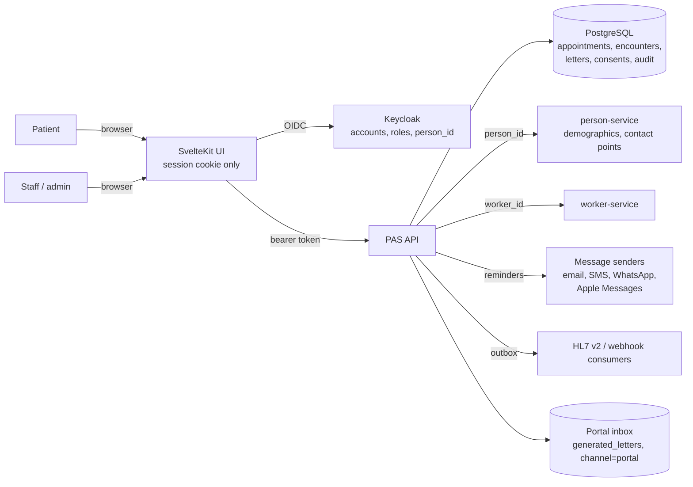

# Data flow (DRAFT)

## What leaves the PAS, and when

| To | What | Trigger | Notes |
|---|---|---|---|
| Message sender (email/SMS/WhatsApp/Apple Messages) | Recipient address and rendered text | A reminder or a generated letter | **Today: log-only senders; nothing is sent.** When real senders exist, the text should carry no clinical detail and link to the portal |
| Event consumers | Event type and ids, per the outbox payload | Every state change | Payloads can contain personal data (see inventory: `free-text`) |
| Browser | Pages for the signed-in role only | A request | Tokens never leave the UI server |

## What the PAS does not hold

Patient demographics, contact details and staff records live in `person-service` and `worker-service`. The PAS stores their ids. The contact point used for a message is fetched at send time and not stored (the rendered text is).

## Open

- Where each service is hosted (country) is a deployment decision. See the DPIA.
- Sub-processors (message carriers) are not chosen yet.
