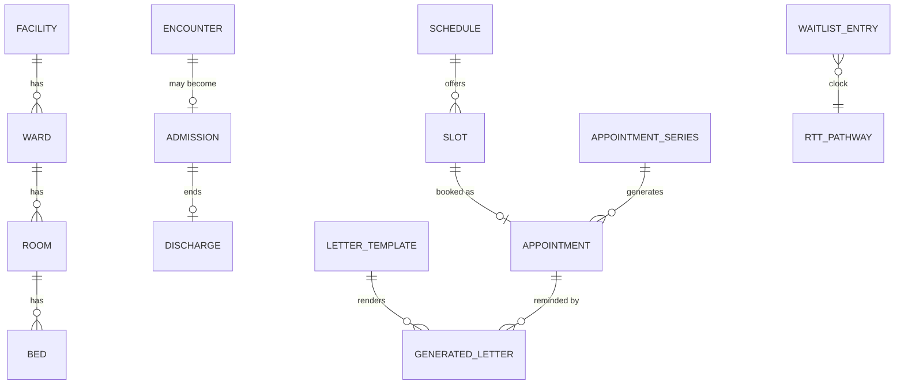

# 5. Domain model

Authoritative field-level detail is in the server's [`spec.md`](../patient-administration-system-with-rust/spec.md) and `src/models/`. This chapter fixes the vocabulary and the rules other chapters rely on.

People are not modelled here. Rows carry `person_id` (patient) and `worker_id` (staff) from the upstream services.

## Appointment status

`proposed → booked → arrived → fulfilled`, with `cancelled` and `no_show` as terminal states. A transition to the same state, or out of a terminal state, MUST be rejected.

## Delivery channels

`print` (postal letter), `email`, `sms`, `whatsapp`, `apple_messages`, `portal`. A template lists its channels in preference order.

| Channel | Recipient | Delivered when |
|---|---|---|
| `print` | none | an operator marks the letter sent |
| `email` | patient's email | the email sender accepts it |
| `sms`, `whatsapp` | patient's phone | the sender accepts it |
| `apple_messages` | phone, else email | the sender accepts it |
| `portal` | none (the patient signs in) | the moment it is stored |

A letter has status `pending`, `sent` or `failed`. A `sent` or `pending` letter for an appointment and template means that appointment has been reminded.

## Template variables

`patient` (the upstream person), `appointment` (`id`, `start`, `end`, `reason`) for reminders, and `portal_url` when `PAS_PORTAL_URL` is set.
