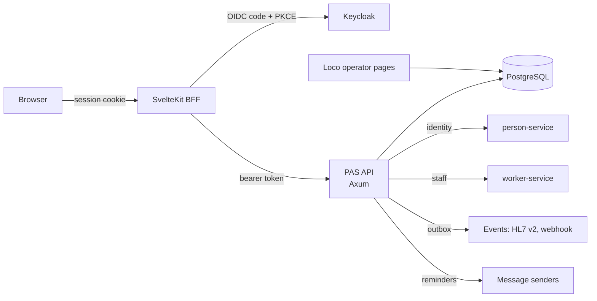

# 8. Architecture

## Components

| Component | Tech | Port (dev) |
|---|---|---|
| PAS API | Rust 2024, Axum 0.8, SeaORM, utoipa | 8080 |
| Operator pages | Loco 0.14, Tera, HTMX | 5150 |
| UI | SvelteKit 3, Svelte 5, Lily | 5173 |
| Database | PostgreSQL 18 | 5432 |
| Identity provider | Keycloak 26 | 8180 |

## Rules

- **Backend-for-frontend.** The browser holds only an opaque httpOnly `__Host-` session cookie. ID, access and refresh tokens, and the API bearer token, stay on the SvelteKit server.
- **Server-side authorization.** Each page and form action checks the role itself. Navigation only hides links.
- **Transactional outbox.** A change, its audit row and its event commit together.
- **Fail closed.** An unverified token, a missing claim, an unknown channel or a template syntax error is refused, not defaulted.
- **Channels are pluggable.** Each is a `MessageSender`; with none configured, nothing leaves the system.
